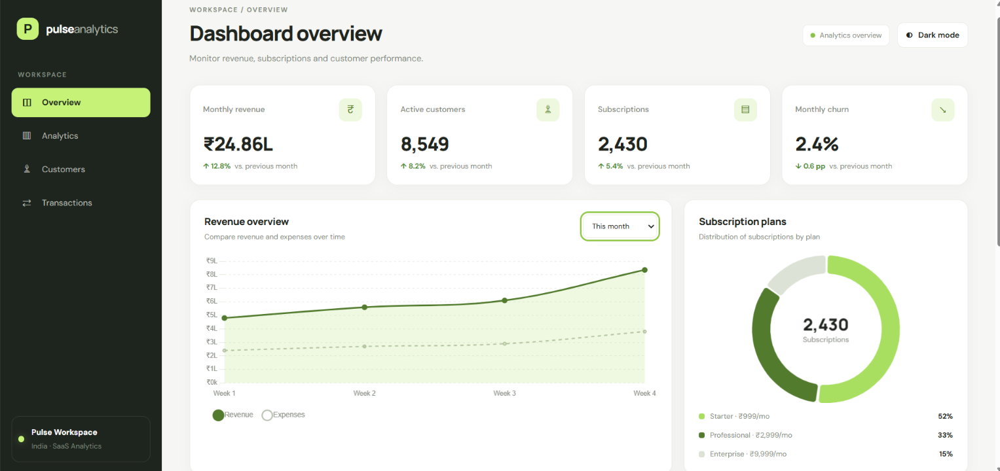

# Pulse Analytics Dashboard

A modern, responsive SaaS analytics dashboard built using HTML, CSS, JavaScript, and Chart.js to visualize business performance, revenue trends, customer activity, and subscription metrics.

## 📊 Dashboard Preview



## ✨ Features

- **Dashboard Overview:** Displays key business performance indicators.
- **KPI Cards:** Shows monthly revenue, active customers, subscriptions, and monthly churn.
- **Revenue Analytics:** Visualizes revenue and expenses using interactive charts.
- **Subscription Plans:** Displays subscription distribution across Starter, Professional, and Enterprise plans.
- **Dark Mode:** Switch between light and dark themes.
- **Sidebar Navigation:** Includes Overview, Analytics, Customers, and Transactions sections.
- **Modern UI:** Clean layout with consistent styling, dashboard cards, and visual analytics.

## 🛠️ Technologies Used

- HTML5
- CSS3
- JavaScript
- Chart.js

## 🚀 Getting Started

### Run Locally

1. Clone this repository:

   ```bash
   git clone https://github.com/bhaveshsalunke098/pulse-analytics-dashboard.git
   ```

2. Open the project folder.
3. Open `index.html` in your web browser.

## 📁 Project Structure

```text
pulse-analytics-dashboard/
├── index.html
├── style.css
├── script.js
├── favicon.png
├── dashboard-preview.png
└── README.md
```

## 🎯 Project Objective

The objective of Pulse Analytics is to present business metrics through a clean and interactive dashboard interface, making revenue trends, customer activity, and subscription performance easier to understand.

## 👨‍💻 Author

**Bhavesh Salunke**

- GitHub: [bhaveshsalunke098](https://github.com/bhaveshsalunke098)

---

If you find this project useful, feel free to explore the repository!
